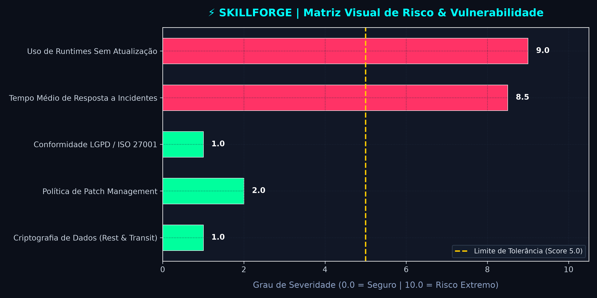

# ⚡ SkillForge CyberSec & Intelligence Agent (`@skillforge/cyber-core`)

[](#)
[](#)
[](#)
[](LICENSE)

> **Engenharia de dados, automações defensivas e desmistificação de fake news em cibersegurança.**

---

## 🎯 Propósito e Missão

O **SkillForge Security & Data Intelligence Agent** é uma iniciativa técnica focada em entregar análises rigorosas, ferramentas de auditoria e dashboards visuais com rigor científico, eliminando o alarmismo e a desinformação (*fake news*) na área de tecnologia e segurança da informação.

### 🛡️ Princípios Operacionais Inegociáveis
1. **Tolerância Zero ao Achismo:** Todas as análises cruzam fontes primárias oficiais (**NIST NVD**, **OWASP**, **GitHub Advisories**, **PyPI**, notas oficiais de lançamento).
2. **Anti-Fake News Ativo:** Desconstrução de boatos midiáticos explicando a causa-raiz técnica de falhas (ex: análise real de vulnerabilidades de corrupção de memória e CVEs oficiais vs pânico generalizado).
3. **Hands-On & Data-Driven:** Código funcional, testes automatizados e visualizações em alta resolução com estética Cyberpunk / Dark Mode.

---

## 📊 Matriz Visual de Risco

O módulo [`risk_analyzer.py`](risk_analyzer.py) realiza auditorias de métricas corporativas, categoriza Green Flags vs. Red Flags e aciona alertas críticos com base em limites de tolerância estipulados:



---

## 🚀 Instalação e Execução

### Pré-requisitos
- Python 3.10 ou superior
- Git

### 1. Clonar o repositório
```bash
git clone https://github.com/pontelyasmin-crypto/skillforge-cybersec-agent.git
cd skillforge-cybersec-agent
```

### 2. Configurar o ambiente virtual e dependências
```bash
python -m venv venv

# Windows
.\venv\Scripts\activate

# Linux / macOS
source venv/bin/activate

pip install -r requirements.txt
```

### 3. Executar o analisador de risco
```bash
python risk_analyzer.py
```

---

## 🧠 Skills do Agente Antigravity

Este repositório implementa o padrão oficial de **Skills** do ecossistema Antigravity em `.agents/skills/` e `skills/`:

### ⚡ `cybersec-risk-audit`
- **Definição:** [`SKILL.md`](skills/cybersec-risk-audit/SKILL.md)
- **Função:** Auditoria técnica de risco, checagem contra NIST SP 800-52/800-61, OWASP ASVS e CIS Controls, aplicação do protocolo anti-fake news e emissão automatizada de alerta crítico.
- **Script Executável:** [`run_audit.py`](skills/cybersec-risk-audit/scripts/run_audit.py)
- **Exemplo de Entrada:** [`sample_audit_input.json`](skills/cybersec-risk-audit/examples/sample_audit_input.json)
- **Guias de Referência:**
  - [Benchmarks Oficiais NIST & OWASP](skills/cybersec-risk-audit/references/nist_owasp_benchmarks.md)
  - [Protocolo Anti-Fake News](skills/cybersec-risk-audit/references/anti_fake_news_protocol.md)

```bash
# Executar a skill com dados de exemplo
python skills/cybersec-risk-audit/scripts/run_audit.py --input skills/cybersec-risk-audit/examples/sample_audit_input.json --output audit_result.png
```

---

## 📂 Estrutura do Repositório

```text
├── .agents/skills/cybersec-risk-audit/ # Skill em padrão Antigravity
│   ├── SKILL.md                       # Especificação da skill com frontmatter
│   ├── scripts/run_audit.py           # Helper executável da auditoria
│   ├── examples/sample_audit_input.json
│   └── references/                    # Benchmarks NIST/OWASP e Anti-Fake News
├── skills/                            # Espelho público de skills para GitHub
├── .gitignore                         # Exclusões de ambiente, caches e segredos
├── AGENTS.md                          # Diretrizes de persona e regras do agente
├── README.md                          # Documentação executiva
├── requirements.txt                   # Dependências Python (pandas, matplotlib)
├── risk_analyzer.py                   # Script de análise isolada
└── security_risk_matrix.png           # Matriz visual renderizada
```

---

## 📜 Licença
Distribuído sob a licença MIT. Consulte `LICENSE` para mais informações.

